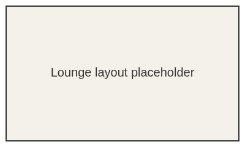

# Operations and Location

## Site Requirements

TODO: Describe size, zoning, acoustics, foot traffic, and access needs.

## Layout

TODO: Describe how retail, lounge, bar, and storage space are arranged.

## Suppliers and Sourcing

TODO: Describe distributors, used-record sourcing, and beverage suppliers.

## Hours

TODO: Describe opening hours by day and seasonal changes.

## Staffing Model

TODO: Describe who is needed on the floor and behind the bar, and when.
